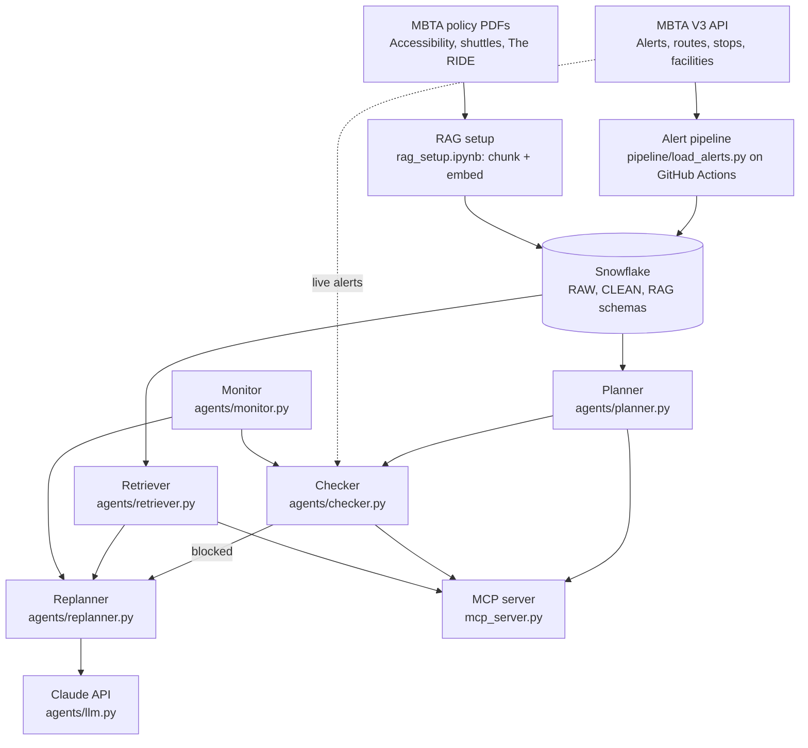

 # TransitWise Boston: Architecture

## System architecture

## Data architecture

| Layer | Components |
|---|---|
| Sources | MBTA V3 API; MBTA policy PDFs in `policy_docs/` |
| Ingestion | `pipeline/load_alerts.py` (scheduled on GitHub Actions); one-time loads for reference tables; `rag_setup.ipynb` for policy chunks |
| Storage | Snowflake `TRANSITWISE_DB`: `RAW` (as loaded), `CLEAN` (SQL views), `RAG` (policy chunks with embeddings) |
| Consumption | Planner, Checker, Retriever, Replanner, Monitor; MCP tools |