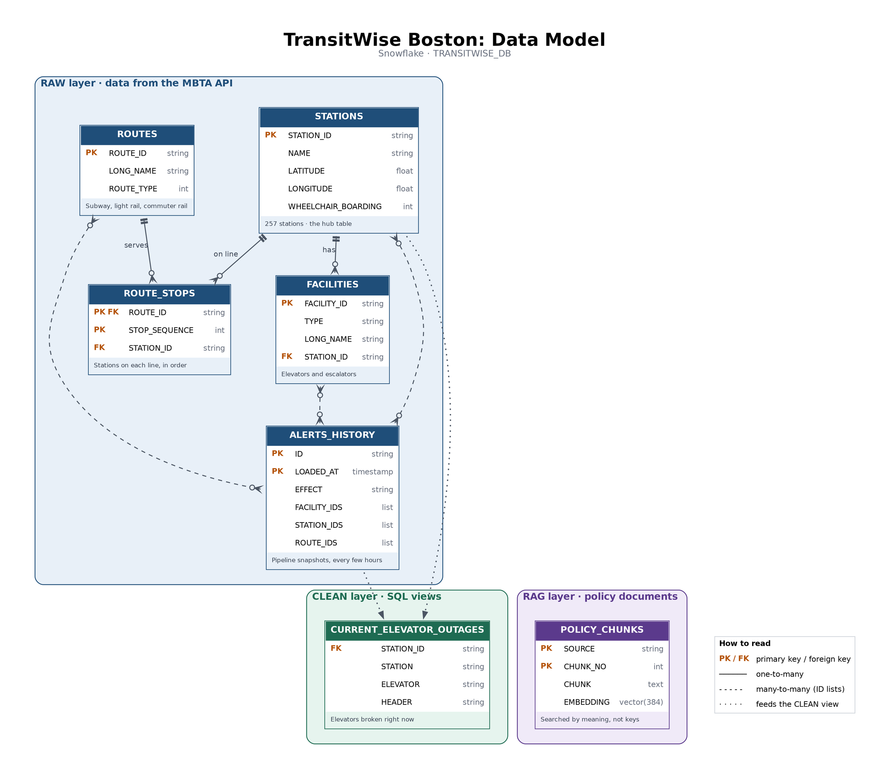
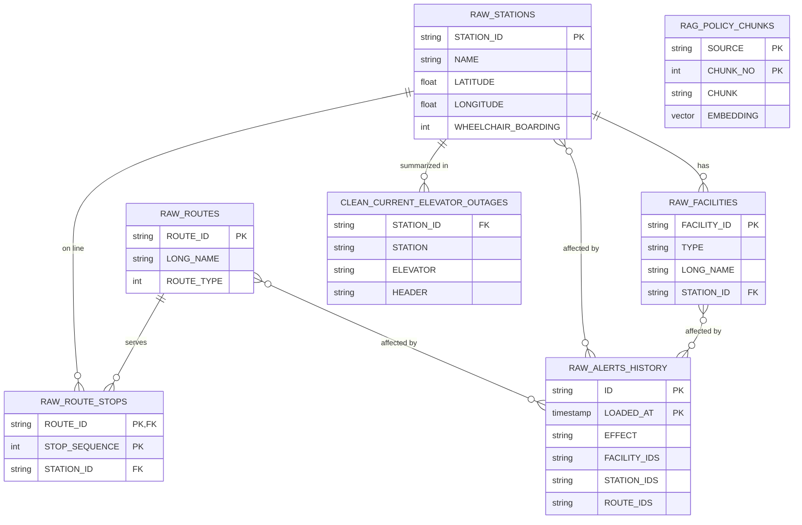

# TransitWise Boston: Data Model

TransitWise stores its data in **Snowflake**, in the database `TRANSITWISE_DB`, organized into three layers:

| Schema | Purpose |
|---|---|
| `RAW` | Data loaded from the MBTA V3 API |
| `CLEAN` | SQL views built from RAW data |
| `RAG` | MBTA policy documents, split into passages with vector embeddings |

## ER diagram (as code)

## Tables

### RAW layer

**`ROUTES`**: subway, light rail, and commuter rail lines
| Key | Column | Type |
|---|---|---|
| PK | ROUTE_ID | string |
| | LONG_NAME | string |
| | ROUTE_TYPE | int |

**`STATIONS`**: 257 stations; the hub table
| Key | Column | Type |
|---|---|---|
| PK | STATION_ID | string |
| | NAME | string |
| | LATITUDE | float |
| | LONGITUDE | float |
| | WHEELCHAIR_BOARDING | int |

**`ROUTE_STOPS`**: stations on each line, in order
| Key | Column | Type |
|---|---|---|
| PK, FK → ROUTES | ROUTE_ID | string |
| PK | STOP_SEQUENCE | int |
| FK → STATIONS | STATION_ID | string |

**`FACILITIES`**: elevators, escalators, and boarding lifts
| Key | Column | Type |
|---|---|---|
| PK | FACILITY_ID | string |
| | TYPE | string |
| | LONG_NAME | string |
| FK → STATIONS | STATION_ID | string |

**`ALERTS_HISTORY`**: append-only alert snapshots from the pipeline
| Key | Column | Type |
|---|---|---|
| PK | ID | string |
| PK | LOADED_AT | timestamp |
| | EFFECT | string |
| | FACILITY_IDS | comma-separated list |
| | STATION_IDS | comma-separated list |
| | ROUTE_IDS | comma-separated list |

### CLEAN layer

**`CURRENT_ELEVATOR_OUTAGES`** (view): elevators out of service in the latest snapshot
| Key | Column | Type |
|---|---|---|
| FK → STATIONS | STATION_ID | string |
| | STATION | string |
| | ELEVATOR | string |
| | HEADER | string |

### RAG layer

**`POLICY_CHUNKS`**: MBTA policy passages, searched by meaning
| Key | Column | Type |
|---|---|---|
| PK | SOURCE | string |
| PK | CHUNK_NO | int |
| | CHUNK | text |
| | EMBEDDING | VECTOR(FLOAT, 384) |

## Relationships

| From | To | Type |
|---|---|---|
| ROUTES | ROUTE_STOPS | One-to-many |
| STATIONS | ROUTE_STOPS | One-to-many |
| STATIONS | FACILITIES | One-to-many |
| ROUTES, STATIONS, FACILITIES | ALERTS_HISTORY | Many-to-many, through ID lists |
| ALERTS_HISTORY + STATIONS | CURRENT_ELEVATOR_OUTAGES | Feed the view |

`POLICY_CHUNKS` has no key relationships. It is searched by vector similarity.

## How the tables are created

| Table | Created by | Load pattern |
|---|---|---|
| Database and schemas | `sql/01_setup.sql` | One time |
| ROUTES, STATIONS, ROUTE_STOPS, FACILITIES | Python (MBTA API → pandas → `write_pandas`) | Loaded once, refreshed by overwrite |
| ALERTS_HISTORY | `pipeline/load_alerts.py` on GitHub Actions | Appended on a schedule |
| CURRENT_ELEVATOR_OUTAGES | SQL `CREATE VIEW` | Recomputed on every query |
| POLICY_CHUNKS | `rag_setup.ipynb` (PDF chunks → MiniLM embeddings) | Loaded once |

## Notes

- Only key columns are shown; some tables have additional columns.
- Keys are logical. Snowflake records but does not enforce them; the code joins on these keys.
- `ALERTS_HISTORY` repeats an alert in every snapshot while it is active, so its key is `ID` + `LOADED_AT`.
- ID list columns are split with `SPLIT_TO_TABLE` in the CLEAN view. `STATION_IDS` also includes platform and entrance IDs; only `place-` IDs match `STATIONS`.
- Alert snapshots before 2026-10-23 have empty ID columns.
- The Checker agent reads live alerts from the MBTA API. The CLEAN view is used for analysis and reporting.
